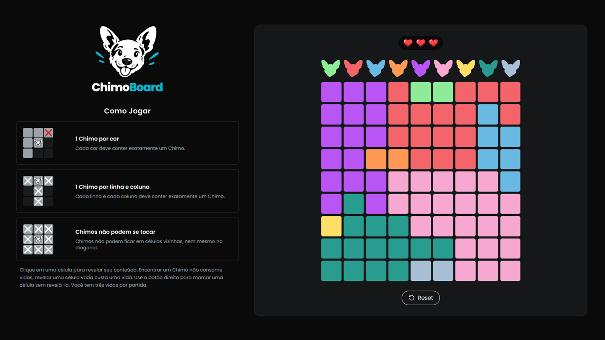

# ChimoBoard 🐶

ChimoBoard is a logic puzzle game that combines elements of Sudoku and Minesweeper. Find every hidden Chimo by following the rules of rows, columns, and colored regions — without running out of lives.



## How to Play

- Each row must contain exactly one Chimo.
- Each column must contain exactly one Chimo.
- Each colored region must contain exactly one Chimo.
- Chimos cannot occupy adjacent cells, including diagonals.
- **Left-click** a cell to reveal it.
- Finding a Chimo reveals its face. Revealing an empty cell costs one life.
- **Right-click** to mark or unmark a cell with a white X. Marks do not reveal cells or consume lives.
- You start with **3 lives**. Find every Chimo to win; lose all your lives and the game ends.

Revealed cells remain visible. After winning or losing, you can restart the game or play again with a new puzzle.

## Tech Stack


## Technical Highlights

- Procedural puzzle generation with connected regions.
- Backtracking solver to validate puzzle uniqueness.
- Domain logic separated from UI components.
- Automated tests with Vitest and React Testing Library.

## Run Locally

```bash
git clone https://github.com/itsmesiq/chimoboard.git
cd chimoboard
pnpm install
pnpm dev
```
